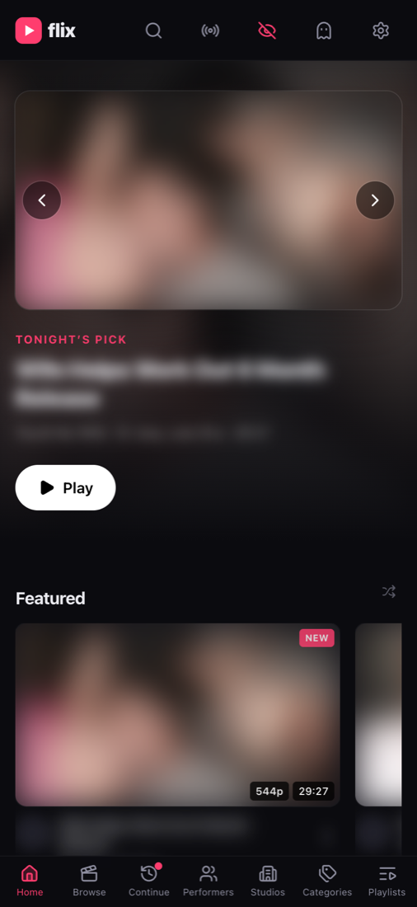
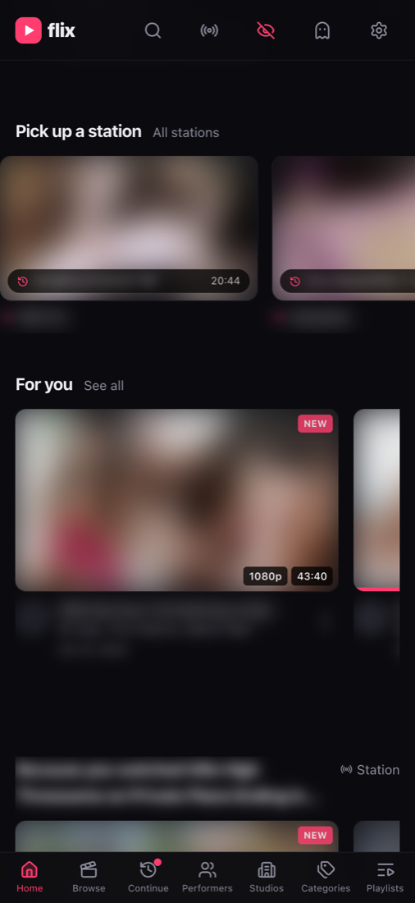
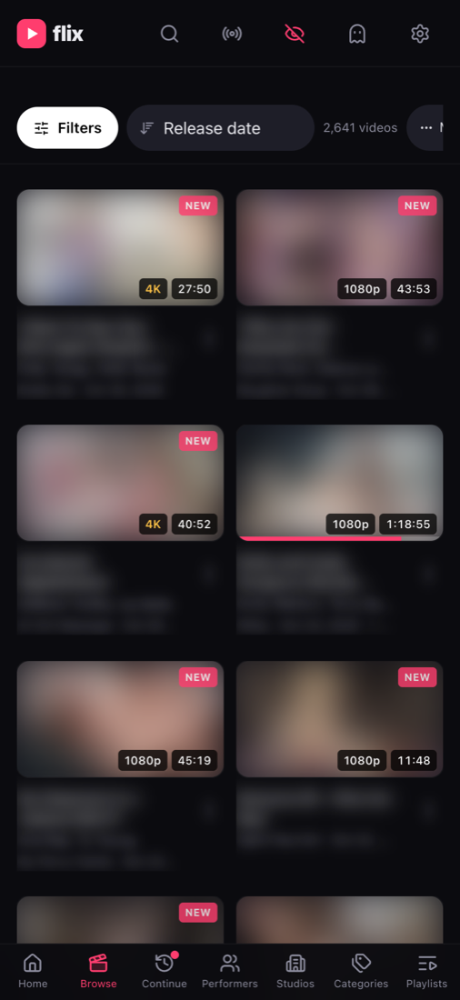
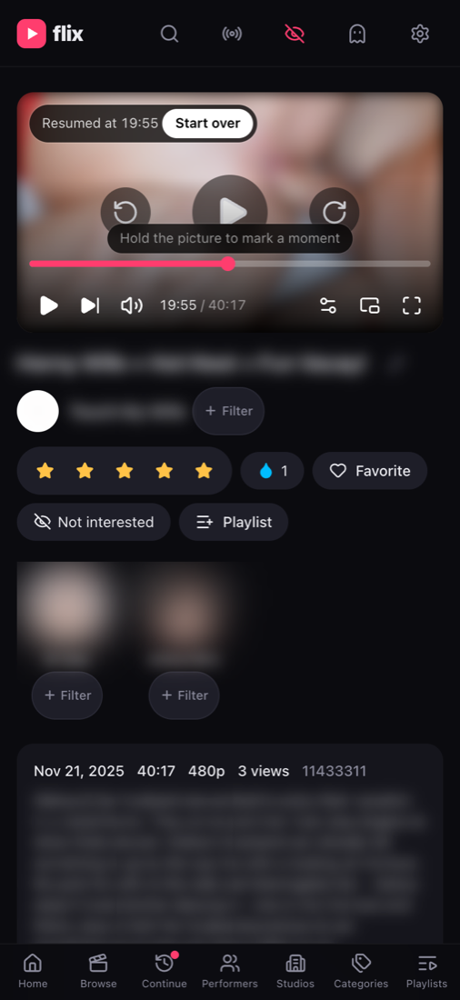
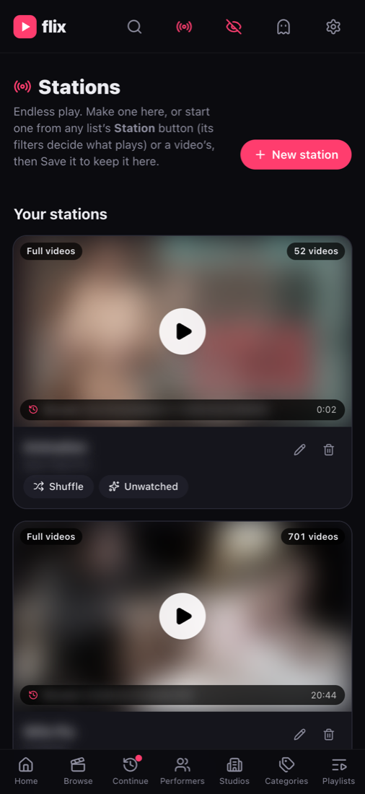
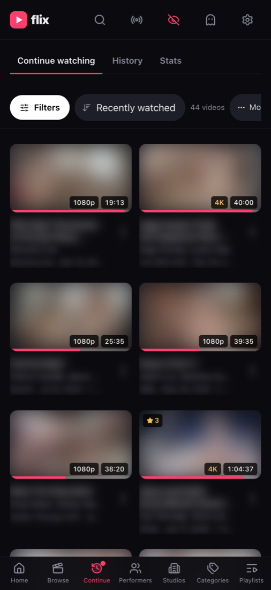
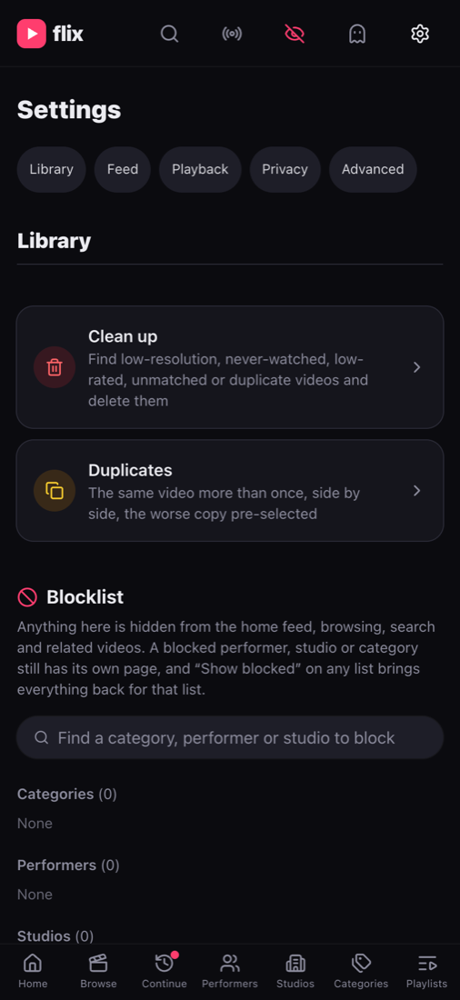

# stashtube

A tube-style web front end for a [Stash](https://github.com/stashapp/stash) library. Stash stays
the headless backend (scanning, fingerprints, StashDB metadata, sprites and previews,
transcodes); stashtube adds the parts of a video site Stash does not have: a home feed with
ranking, playlists, a global blocklist, endless "stations", related videos, and a phone-first
player with seek thumbnails, moments and a mini-player. It is a small Hono BFF plus a React PWA,
built for one user on a home LAN and installed to an iPhone home screen.

> The code, the Docker image, the wiki and the UI still call the app **flix**. `stashtube` is
> the repository name; a rename of the app itself is pending.

## What it does

- **Home feed** of rows (continue watching, featured, new, by performer, studio and tag, pinned
  Browse filters), scored from ten signals with user-set weights, warmed so a cold open paints at once.
- **Browse, search and filters** over scenes, performers, studios and tags, with live facet
  counts, stackable per-browser filters and multi-select on every list.
- **Player** that direct-plays the original when it can and falls back to Stash's HLS transcode,
  with resume, a quality menu, touch seek with sprite thumbnails and marker ticks, AirPlay,
  and a mini-player that follows you between pages without reloading the video.
- **Moments**: hold or press `b` to mark a marker in Stash, retitle and retag it under the video.
- **Playlists and Favorites** (Postgres), **stations** (endless play from a filter, a scene or a
  playlist, in full or moments mode, with resume), **related videos**.
- **Blocklist** of tags, performers and studios applied to every list, feed and search, plus
  "Not interested" on a video.
- **Library tools**: a cleanup page of likely deletions, a duplicates workbench over Stash's
  perceptual-hash groups, Identify against StashDB, and delete through Whisparr when configured.
- **"Not in your library yet"** shelf on performer and studio pages from StashDB, with a one-click
  Get through Whisparr.
- **Privacy layers**: discreet mode (blurred artwork), a private session that records nothing,
  a PIN lock, a panic URL, and an optional single-password login.
- **Installable**: a PWA with icons and a standalone display mode; keyboard shortcuts on desktop.

Stash owns ratings, play counts, resume points, O-counts, markers, favourites, titles and tags,
so its own UI stays consistent. Postgres holds only what Stash cannot: playlists, the blocklist,
pinned rows, stations and a few settings.

## Screenshots

Taken at iPhone width with discreet mode on (the eye in the header blurs every picture until
touched) and titles blurred for the public repo.

| Home | Home, further down | Browse |
|---|---|---|
|  |  |  |

| Video | Stations | Continue | Settings |
|---|---|---|---|
|  |  |  |  |

## How it fits together

```
 iPhone / browser  ──►  BFF (Hono, Node 26)  ──►  Stash (GraphQL + media)
      React PWA          /api  /media  web/         scans, sprites, previews, HLS
                            │
                            ├──►  Postgres (playlists, blocklist, stations, settings)
                            ├──►  StashDB  (optional, via Stash's stash-box config)
                            └──►  Whisparr (optional, delete + get)
```

The browser never talks to Stash and never sees the API key: every Stash URL is rewritten to
`/media/stash/...` on the BFF, StashDB covers go through `/media/remote/<token>`. The web app
knows only the types in `packages/shared`; `apps/server/src/stash.ts` is the only file that
knows Stash's schema.

## Requirements

| | |
|---|---|
| Stash | v0.31.x (the typed schema is generated from it; see `scripts/stash-schema.mjs` for a newer one), reachable from the BFF, with an API key. Scenes scanned; **sprites and previews generated** if you want seek thumbnails and hover previews. |
| Node | 26 (the server runs `.ts` natively, no build step) |
| pnpm | 11.12 (`packageManager` in `package.json`; `corepack enable` gives you it) |
| Postgres | 16 or newer. `docker compose` starts one for development. |
| Optional | Whisparr (delete and Get), StashDB credentials (read from Stash's stash-box settings by default), a local mount of the same media files for direct play (`MEDIA_PATH_MAP`) |

## Quick start (development)

```sh
git clone https://github.com/BoomstickSoftware/stashtube.git && cd stashtube
pnpm install
pnpm db:up                    # Postgres 18 in Docker on 127.0.0.1:5433
cp .env.example .env          # set STASH_URL and STASH_API_KEY; leave DATABASE_URL as is
pnpm dev                      # BFF on :8080 (node --watch) + Vite
```

Open the URL Vite prints (5173 by default). Vite proxies `/api` and `/media` to the BFF on 8080.
Migrations run when the BFF starts. The first Home load fetches a lot from Stash; everything is
cached after that, and at `WARM_AT_UTC` (06:00 UTC by default) the BFF pre-fetches all artwork.

If the BFF exits with `STASH_API_KEY is not set`, `.env` is not filled in. The dev script reads
`.env` from the repo root; `pnpm start` expects the variables exported.

## Running it for real

One image serves the API, the media proxy and the built web app. `deploy/docker-compose.yml`
builds it and runs it next to a Postgres:

```sh
cp .env.example .env          # STASH_URL, STASH_API_KEY; optional WHISPARR_*, MEDIA_PATH_MAP
docker compose -f deploy/docker-compose.yml up -d --build
curl -s http://localhost:8080/healthz     # {"ok":true,"version":"..."}
```

Point your phone at the host's address and use "Add to Home Screen". For direct play of the
originals (no transcode for files the device can play) mount the library into the container
and set `MEDIA_PATH_MAP=<stash's path prefix>=<path in the container>`.

The author runs it on a Kubernetes cluster: CI builds the image, scans it with Trivy, pushes it
to a registry and pins the Deployment to the digest. That setup is documented in
`wiki/integrations/kubernetes-deployment.md` and `wiki/integrations/forgejo-ci.md`.

### Exposure

There is **no login by default**. Run it on a LAN or behind a VPN. If it must be reachable more
widely, set `FLIX_PASSWORD` and `FLIX_SESSION_SECRET` (a single-password login with rate limits
and signed playback links), and still put it behind your own reverse proxy and TLS.

## Configuration

Everything is an environment variable, parsed once in `apps/server/src/config.ts`. `.env.example`
lists them with comments; `wiki/architecture/config-env.md` has the full table. The ones that
matter first:

| Variable | Meaning |
|---|---|
| `STASH_URL`, `STASH_API_KEY` | required |
| `DATABASE_URL` | required; Postgres |
| `MEDIA_PATH_MAP` | `stashPrefix=localPrefix[,…]`: serve originals from a local mount instead of streaming through Stash |
| `MEDIA_ORIGIN` | absolute origin for playback links (AirPlay receivers cannot resolve local hostnames) |
| `WHISPARR_URL`, `WHISPARR_API_KEY`, `WHISPARR_PATH_MAP` | turn on Delete and the Get button |
| `FLIX_PASSWORD`, `FLIX_SESSION_SECRET` | optional login |
| `CACHE_DIR`, `ASSET_CACHE_MAX_MB`, `WARM_AT_UTC` | the asset cache on disk and its nightly warm-up |

## Repository layout

```
apps/server      Hono BFF. src/stash.ts is the only Stash-aware module; src/db for Drizzle + migrations
apps/web         Vite + React 19 + Tailwind 4 + TanStack Router (file routes) / Query; the PWA
packages/shared  The API contract types and the few values both sides need
deploy/          docker-compose.yml for running the image with a Postgres
scripts/         Checks, deploy verification, headless phone and desktop checks (scripts/manifest.json)
wiki/            The knowledge base: one small page per question, start at wiki/index.md
Dockerfile       One image: build the web, run the server from source
.forgejo/        The author's CI (build, scan, push, pin the k8s Deployment, smoke test)
```

## Development

```sh
node scripts/check.mjs            # typecheck, web tsc, lint, tests: run before a commit
pnpm test                         # server tests (node --test); no Stash needed
pnpm db:generate                  # after editing apps/server/src/db/schema.ts
node scripts/scripts.mjs list     # every script, what it does and how to call it
node scripts/wiki.mjs search …    # find the page that answers a question
```

Most headless checks (`mobile-check`, `touch-check`, `phone-flow`, `perf-check`) drive the app
at iPhone size in Chrome and block every write that would record a view. The iPhone is the
primary client; verify UI changes at phone width first.

Conventions, the rules that hold everywhere (blocklist on every list, Stash owns activity, the
browser never sees Stash, server code is erasable TypeScript) and how the wiki is kept true are
in `CLAUDE.md` and `wiki/architecture/coding-conventions.md`. The wiki is written for an LLM
assistant as much as for a person; `wiki/roadmap.md` has the status and backlog.

## Status

In daily use since 2026-10-26 by one person on one library. Expect assumptions that fit that
library (adult content tagged through StashDB, Whisparr as the downloader, a NAS mount) and
open issues in `wiki/roadmap.md`. Issues and pull requests are welcome.

## License

[MIT](LICENSE).
